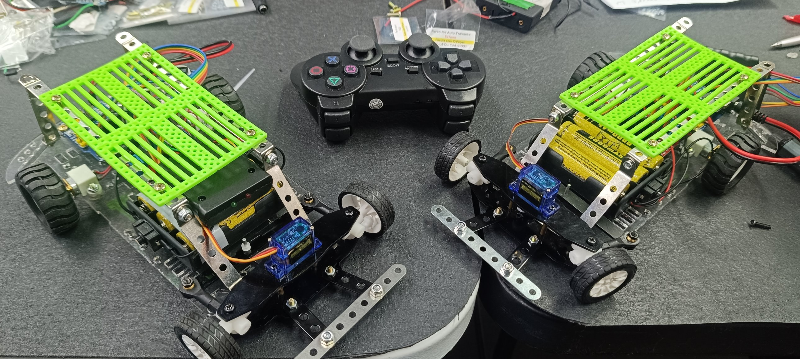
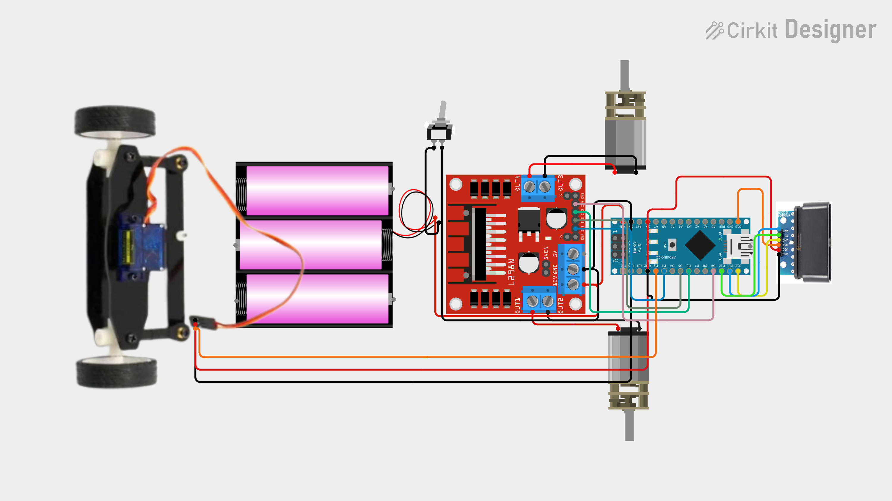

# Fórmula RPS

Carrinho de corrida com direção de verdade (caixa de direção com servo motor), controlado por um joystick de PS2 sem fio. Feito para as atividades da **Robótica Paula Souza** e para quem quer aprender robótica montando, dirigindo e, claro, batendo um pouquinho.

Projeto do **Prof. Rafael Oliveira, o Tio Rafa** - [tiorafa.tec.br](https://tiorafa.tec.br)



---

## 1. Entendimento do projeto

| Item | Valor |
|---|---|
| Placa | Arduino Nano V3.0 (conforme o esquema) |
| IDE | Arduino IDE |
| Driver dos motores | Ponte H L298N |
| Direção | Caixa de direção com micro servo |
| Controle | Joystick PS2 sem fio com receptor |
| Serial | 57600 baud |

Este é um projeto de **Arduino Nano**, e não de ESP32. Ele fica neste repositório com o mesmo padrão de documentação dos projetos ESP32 do Tio Rafa: hardware primeiro, depois pinagem, código, teste e resultado esperado.

### Comportamento esperado

- Botão **X (Cross)** pressionado: o carrinho anda para frente.
- Botão **Círculo** pressionado: o carrinho anda de ré.
- Nenhum dos dois: motores parados.
- **Analógico esquerdo** para a esquerda: roda a direção para a esquerda. Para a direita: roda para a direita. Solto: direção centralizada.
- Se o controle não for encontrado: motores parados, direção no centro, e o Arduino tenta reconectar a cada 2 segundos.

---

## 2. Lista de peças

Todas as peças são encontradas na **[Mamute Eletrônica](https://www.mamuteeletronica.com.br)**, inclusive a caixa de direção com servo motor.

| Peça | Quantidade | Observação |
|---|---:|---|
| Arduino Nano V3.0 | 1 | Cérebro do carrinho |
| Ponte H L298N | 1 | Aciona os dois motores de tração |
| Motor com caixa de redução e roda | 2 | Tração |
| Caixa de direção com servo motor | 1 | Servo ligado ao pino D2 |
| Receptor de joystick PS2 sem fio | 1 | Ligado nos pinos D10 a D13 |
| Controle de PS2 sem fio | 1 | Par do receptor |
| Suporte de baterias 18650 | 1 | O esquema desenha 3 células |
| Baterias 18650 | conforme o suporte | Alimentação geral |
| Chave liga/desliga | 1 | Em série com a alimentação |
| Chassi de acrílico, rodas e ferragens | 1 | Como na foto |
| Fios jumper | vários | Ligações |

---

## 3. Hardware e pinagem

Pinagem conferida entre o código e o esquema do Cirkit Designer.



### Ponte H L298N

| Sinal do L298N | Pino do Nano | Função no código |
|---|---|---|
| IN1 | D3 (PWM) | `in1` |
| IN2 | D5 (PWM) | `in2` |
| IN3 | D6 (PWM) | `in3` |
| IN4 | D9 | `in4` |

Sentido de giro usado no código:

| Movimento | IN1 | IN2 | IN3 | IN4 |
|---|---|---|---|---|
| Frente (X) | 0 | PWM | PWM | 0 |
| Ré (Círculo) | PWM | 0 | 0 | PWM |
| Parado | LOW | LOW | LOW | LOW |

### Servo da direção

| Sinal | Pino do Nano |
|---|---|
| Sinal do servo | D2 |

Ângulos: esquerda 60, centro 90, direita 120. Ajuste `leftPos`, `centerPos` e `rightPos` para o seu carrinho.

### Receptor do joystick PS2

| Receptor | Cor do fio no esquema | Pino do Nano | Define no código |
|---|---|---|---|
| DAT | Laranja | D13 | `PS2_DAT` |
| CMD | Amarelo | D12 | `PS2_CMD` |
| CS (SEL) | Verde | D10 | `PS2_SEL` |
| CLK | Azul | D11 | `PS2_CLK` |
| VCC | Vermelho | 5V | Conforme o esquema |
| GND | Preto | GND | |

### Alimentação (conforme o esquema)

```text
Baterias 18650 -> chave -> L298N (entrada 12V / GND)
L298N (saída 5V / GND) -> Nano (5V / GND), receptor PS2 e servo
```

Todos os GNDs são comuns. Confira no seu módulo se o jumper do regulador de 5 V do L298N está colocado e se a tensão do pacote de baterias está dentro do que o L298N aceita.

---

## 4. Bibliotecas

| Biblioteca | De onde vem | Observação |
|---|---|---|
| `Servo` | Já vem com a Arduino IDE | Controla o servo da direção |
| `PS2X_lib` | Pasta [`libs/`](libs) | Lê o controle de PS2. Licença GPL v3 |

---

## 5. Como instalar e gravar

1. Instale a Arduino IDE.
2. Instale a `PS2X_lib`: Sketch > Incluir Biblioteca > Adicionar biblioteca .ZIP, e escolha [`libs/PS2X_lib.zip`](libs/PS2X_lib.zip).
3. Abra [`firmware/FormulaRPS/FormulaRPS.ino`](firmware/FormulaRPS/FormulaRPS.ino).
4. Em Ferramentas, selecione a placa **Arduino Nano** e a porta USB correta. No processador, escolha entre ATmega328P e ATmega328P (Old Bootloader) conforme o seu Nano: se o upload falhar com um, tente o outro.
5. Faça o upload.
6. Abra o Monitor Serial em **57600**.

---

## 6. Como usar

1. Monte tudo conforme o esquema e ligue a chave.
2. Ligue o controle de PS2. Ele precisa ser o par do receptor.
3. No Monitor Serial deve aparecer: `Controle PS2 sem fio encontrado e configurado com sucesso`.
4. Dirija:

| Controle | Ação |
|---|---|
| Analógico esquerdo (esquerda) | Direção para a esquerda |
| Analógico esquerdo (direita) | Direção para a direita |
| X (Cross) | Frente |
| Círculo | Ré |

O limite do analógico é: menor que 100 vira esquerda, maior que 150 vira direita, entre os dois fica no centro.

---

## 7. Testes

Teste na ordem abaixo. Na primeira vez, com as **rodas fora do chão**.

| Teste | Ação | Resultado esperado | Resultado real |
|---|---|---|---|
| 01 | Ligar a chave | Monitor Serial mostra a mensagem de controle configurado | |
| 02 | Ligar o controle | Receptor reconhece o controle | |
| 03 | Analógico para a esquerda | Servo vai para 60 e as rodas viram | |
| 04 | Analógico para a direita | Servo vai para 120 e as rodas viram | |
| 05 | Soltar o analógico | Servo volta para 90 | |
| 06 | Apertar X | As duas rodas de tração giram para frente | |
| 07 | Apertar Círculo | As duas rodas de tração giram para trás | |
| 08 | Soltar os botões | Motores param | |
| 09 | Desligar o receptor ou desconectar o controle | Motores param e a direção centraliza | |

A coluna **Resultado real** deve ser preenchida só depois do teste no carrinho.

---

## 8. Pontos de atenção

Anotados na revisão do código. O código original foi mantido exatamente como o Tio Rafa escreveu.

- **PWM nos pinos 9 e 10 com a biblioteca Servo.** No Arduino Nano (ATmega328), a biblioteca `Servo` usa o Timer1, que também controla o PWM dos pinos 9 e 10. Hoje `maxSpeed` vale 255, e `analogWrite(pino, 255)` liga o pino direto, então o motor ligado ao `in4` (D9) funciona. Se você diminuir o `maxSpeed` para controlar velocidade, o motor do `in4` pode não responder como o do `in3`. Se quiser velocidade variável, vale lembrar que os seis pinos PWM do Nano (D3, D5, D6, D9, D10 e D11) já estão em uso neste projeto. O caminho seria mover uma linha do receptor PS2 (por exemplo o CLK, hoje no D11) para um pino comum como D4, D7 ou D8, e passar o `in4` para o D11, que usa outro timer. Isso muda a fiação e o código, então refaça o esquema antes.
- **Reconexão bloqueante.** Quando o controle não é encontrado, o código faz `delay(2000)` antes de tentar de novo, e nesse tempo o carrinho não responde a nada.
- **Perda de sinal depois de conectado.** O código só para os motores quando a configuração inicial falha. Se o controle for desligado depois de funcionando, o comportamento depende do que o receptor devolve ao `read_gamepad`, e isso deve ser verificado no carrinho (teste 09).
- **Alimentação.** Motores geram ruído e queda de tensão. Se o Nano reiniciar quando o carrinho acelera, olhe a alimentação antes de mexer no código.

---

## 9. Validação

| Item | Estado |
|---|---|
| Análise do código | Feita. Pinos conferidos contra o esquema, e as chamadas da `PS2X_lib` conferidas contra o cabeçalho da biblioteca |
| Compilação | Não executada nesta documentação |
| Teste em hardware | A registrar pelo autor na tabela de testes |

---

## 10. Estrutura do repositório

```text
Formula-RPS/
├── README.md
├── LICENSE
├── firmware/
│   └── FormulaRPS/
│       └── FormulaRPS.ino
├── libs/
│   ├── README.md
│   ├── PS2X_lib.zip
│   └── PS2X_lib/
└── docs/
    └── imagens/
        ├── formula-rps-foto.jpg
        └── esquema-ligacao.png
```

---

## Créditos e licença

- Código e projeto: Prof. Rafael Oliveira (Tio Rafa), 2025, licença [MIT](LICENSE).
- `PS2X_lib`: Bill Porter e colaboradores, licença GPL v3 (veja [`libs/README.md`](libs/README.md)).
- Esquema feito no Cirkit Designer.
- Peças: Mamute Eletrônica.

Dúvidas, ideias e fotos do seu Fórmula RPS: contato@tiorafa.tec.br - YouTube, Instagram e TikTok: @prof.tiorafa
